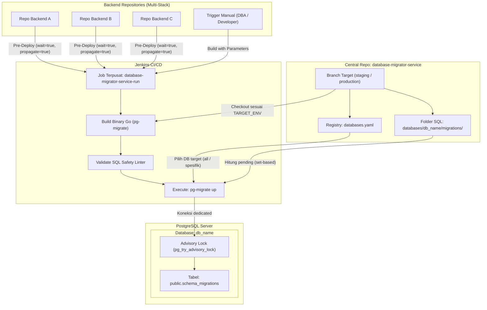
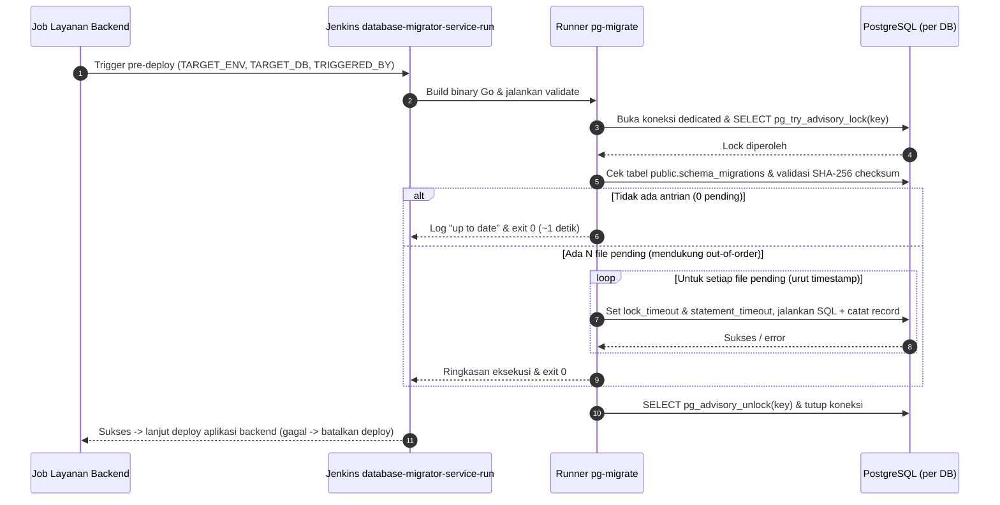
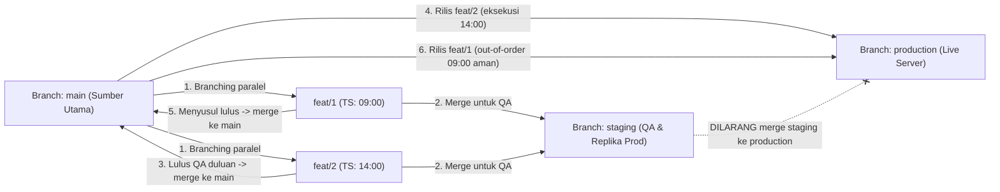

# database-migrator-service

Sistem **Centralized Multi-Database PostgreSQL Migration** untuk mengelola skema pada lingkungan multi-repository backend lintas stack (Node.js, Go, Python, Java, dll.) yang berbagi server PostgreSQL.

Fitur utama:
- **Pre-deploy terpusat via Jenkins:** Setiap deploy ke `staging` atau `production` memanggil runner migrasi (mengeksekusi file pending, atau selesai sebagai *no-op* jika tidak ada antrian).
- **Single binary `pg-migrate`:** Dibangun menggunakan Go (`CGO_ENABLED=0`) sehingga mudah dijalankan di CI/CD maupun container.
- **Multi-database & branch paralel:** Mendukung database existing (`baseline`), registry multi-database (`databases.yaml`), *advisory lock* per database (`pg_try_advisory_lock`), serta *out-of-order execution* (`feat-1`, `feat-2`, dst.).

### Dokumentasi Lengkap
Panduan penggunaan, arsitektur internal, dan runbook operasional tersedia di folder [`docs/`](docs/README.md):
- **[Indeks Dokumentasi (`docs/README.md`)](docs/README.md)** — Peta dokumentasi lengkap.
- **[User Guide & Index](docs/user/README.md)** — Quickstart lokal, konfigurasi, referensi CLI `pg-migrate`, linter, dan SOP branching.
- **[Architecture Internals](docs/internals/01_architecture.md)** — Desain sistem, alur komponen, dan batas tanggung jawab paket Go.
- **[Development Runbook](docs/operations/00_development.md)** — Panduan pengembangan lokal, Docker, dan build binary.

---

## 1. Arsitektur & Cara Kerja



### Alur Eksekusi Saat Deploy



### Mengapa Aman untuk Multi-Repo & Multi-Branch Paralel?
1. **Tracking Set-Based (Per-File), Bukan Angka Versi Tunggal:** `pg-migrate` membandingkan daftar file di branch target terhadap tabel `public.schema_migrations`. Fitur yang masuk `production` belakangan dengan timestamp lebih lama (`feat-1`) tetap dieksekusi tanpa konflik meskipun `feat-2` sudah rilis lebih dulu.
2. **PostgreSQL Advisory Lock (`pg_try_advisory_lock`):** Jika 2–3 repo backend deploy bersamaan di Jenkins, hanya satu yang mengeksekusi migrasi pada database yang sama; yang lain menunggu lock lepas lalu melihat antrian sudah kosong.
3. **Pengaman Timeout Produksi:** Setiap migrasi menerapkan `lock_timeout` (default `5s`) dan `statement_timeout` (default `60s`) agar `ALTER TABLE` tidak menyebabkan antrian lock yang melumpuhkan query aplikasi backend.
4. **SQL Safety Linter & Checksum SHA-256:** Mencegah pengubahan file yang sudah terpasang, memblokir DDL destruktif tanpa anotasi eksplisit, dan menolak `CONCURRENTLY` yang dijalankan di dalam transaksi.

---

## 2. Struktur Proyek

```text
database-migrator-service/
├── cmd/pg-migrate/               # CLI entrypoint (up, status, validate, create, baseline, version)
├── internal/
│   ├── config/                   # Parser & validator databases.yaml + resolver DSN PostgreSQL
│   ├── migration/                # Parser file SQL, directive header, splitter statement PG, safety linter
│   └── runner/                   # Engine eksekusi (postgres_store.go, runner.go)
├── databases/
│   └── db_name/                  # Template database awal (ganti dengan nama DB asli Anda)
│       ├── baseline/             # Maksimal 1 file 00000000000000_*.sql untuk snapshot schema awal
│       └── migrations/           # File migrasi incremental YYYYMMDDHHmmss_<service>_<desc>.sql
├── docs/                         # Dokumentasi terstruktur (user guide, internals, operations runbooks)
├── jenkins/
│   ├── Jenkinsfile                    # Pipeline job terpusat database-migrator-service-run
│   ├── backend-pipeline-snippet.groovy # Snippet untuk Jenkinsfile repository backend
│   └── backend-freestyle-guide.md     # Panduan untuk Jenkins Freestyle Job
├── scripts/
│   ├── init-local-postgres.sql   # Inisialisasi role & database lokal PostgreSQL untuk Docker
│   ├── dump-baseline.sh          # Helper pg_dump --schema-only
│   └── build-linux.sh            # Cross-compile binary Linux amd64
├── databases.yaml                # Registry database PostgreSQL
├── docker-compose.local.yml      # PostgreSQL 16 lokal untuk pengujian developer
├── Dockerfile                    # Image ringan non-root untuk runner pg-migrate
├── Makefile
└── .env.example
```

> **Catatan:** Folder `databases/db_name` adalah **template awal** (sudah diselaraskan dengan `scripts/init-local-postgres.sql` agar bisa langsung dicoba di Docker lokal). Saat memakai repo ini untuk proyek Anda, sesuaikan folder & `databases.yaml` dengan nama database asli Anda (lihat [Bagian 4](#4-menyesuaikan-template-db_name--menambah-database-baru)).

---

## 3. Quickstart Lokal (Developer)

### Konsep Singkat: Apa itu Baseline?
**Baseline** adalah *titik nol* (snapshot struktur skema awal, tanpa data) sebelum database mulai dikelola oleh `database-migrator-service`, yang disimpan di `databases/<db>/baseline/00000000000000_initial_baseline.sql`. Semua perubahan skema setelah titik ini diletakkan di folder `migrations/` sebagai file migrasi incremental. Perintah `baseline` hanya dijalankan **sekali di awal**, sedangkan perintah rutin `pg-migrate up` hanya mengeksekusi file di folder `migrations/` (tidak mengeksekusi ulang file `baseline/`).

| Perintah | Kapan Dipakai | Yang Dilakukan |
|---|---|---|
| `pg-migrate baseline --db=all` *(tanpa `--apply-sql`)* | **Staging & Production** (DB sudah ada tabelnya) | **Tidak** menjalankan SQL; hanya membuat tabel `public.schema_migrations` dan mencatat marker `00000000000000`. |
| `pg-migrate baseline --db=all --apply-sql` | **Lokal / Docker baru** (DB masih kosong) | **Menjalankan** SQL baseline untuk membuat tabel awal lalu mencatat marker (otomatis ditolak jika DB sudah punya riwayat migrasi). |

### A. Menyalakan PostgreSQL Lokal
1. Salin `.env.example` menjadi `.env` (sesuaikan bila perlu):
   - Default lokal sudah mengarah ke `localhost:5432`, user `migrator_user`, password `change_me`, `POSTGRES_SSLMODE=disable` (alias `PG_*` dan fallback `DB_*` juga didukung).
   - Jika port `5432` sudah dipakai PostgreSQL lain di laptop Anda, ubah mapping port pada `docker-compose.local.yml`.
2. Jalankan PostgreSQL lokal via Docker Compose:
   ```bash
   docker compose -f docker-compose.local.yml up -d
   ```
   Script `scripts/init-local-postgres.sql` otomatis membuat `migrator_user`, `app_user`, database `db_name`, serta `ALTER DEFAULT PRIVILEGES` untuk `app_user`. Jika ingin mereset DB lokal kembali bersih dari nol, jalankan `docker compose -f docker-compose.local.yml down -v` lalu `up -d` lagi.
3. Set environment variable (PowerShell) dan terapkan baseline pada database lokal yang masih kosong:
   ```powershell
   $env:POSTGRES_HOST="localhost"
   $env:POSTGRES_PORT="5432"
   $env:POSTGRES_USER="migrator_user"
   $env:POSTGRES_PASSWORD="change_me"
   $env:POSTGRES_SSLMODE="disable"
   $env:GOTOOLCHAIN="local"

   go run ./cmd/pg-migrate baseline --db=all --apply-sql
   ```
   *(Jika Anda tidak menginstall Go di laptop, lewati langkah 3 ini dan langsung gunakan **Opsi B (Full Docker)** di bawah.)*

### B. Opsi Full Docker (Tanpa Perlu Install Go di Host)
1. Build image runner `pg-migrate`:
   ```powershell
   docker build -t pg-migrate:local .
   ```
2. Buat shortcut `pg-migrate` sementara di PowerShell (folder `databases` di-mount read-write agar perintah `create` bisa menulis file baru ke folder lokal):
   ```powershell
   function pg-migrate {
     docker run --rm `
       -e POSTGRES_HOST=host.docker.internal `
       -e POSTGRES_PORT=5432 `
       -e POSTGRES_USER=migrator_user `
       -e POSTGRES_PASSWORD=change_me `
       -e POSTGRES_SSLMODE=disable `
       -v "${PWD}\databases.yaml:/app/databases.yaml:ro" `
       -v "${PWD}\databases:/app/databases" `
       pg-migrate:local @args
   }
   ```
   > *Untuk Linux/macOS (Bash):* gunakan `-v "$(pwd)/databases.yaml:/app/databases.yaml:ro"` dan `-v "$(pwd)/databases:/app/databases"` (di Linux native tambahkan `--add-host=host.docker.internal:host-gateway` bila perlu).
3. Terapkan baseline dan verifikasi tabel awal di container PostgreSQL:
   ```powershell
   pg-migrate status --db=all                      # awal: PENDING_BASELINE
   pg-migrate baseline --db=all --apply-sql        # buat tabel awal + catat marker
   pg-migrate status --db=all                      # berubah menjadi BASELINE
   docker exec db_migrator_service_postgres_local psql -U migrator_user -d db_name -c "\dt"
   ```

### C. Membuat & Menguji Migrasi Baru
> *Catatan:* Jika Anda menggunakan **Opsi B (Full Docker)** di atas, cukup ganti `go run ./cmd/pg-migrate` pada perintah di bawah menjadi `pg-migrate`.

1. Buat file migrasi baru dengan timestamp UTC otomatis:
   ```bash
   go run ./cmd/pg-migrate create --db=db_name --service=order --name=add_discount_column --ticket=PROJ-201
   ```
   Untuk membuat index non-blocking (`CREATE INDEX CONCURRENTLY`), tambahkan `--no-tx`:
   ```bash
   go run ./cmd/pg-migrate create --db=db_name --service=order --name=add_idx_customer_id --no-tx
   ```
2. Tulis DDL PostgreSQL yang backward-compatible di file yang baru dibuat, misalnya untuk menambah kolom pada tabel `public.orders` hasil baseline:
   ```sql
   ALTER TABLE public.orders
   ADD COLUMN IF NOT EXISTS discount_amount NUMERIC(15, 2) NOT NULL DEFAULT 0;
   ```
3. Jalankan validasi linter, cek status, dry-run, lalu apply ke DB lokal:
   ```bash
   go run ./cmd/pg-migrate validate --db=all
   go run ./cmd/pg-migrate status --db=all         # terlihat 1 file PENDING
   go run ./cmd/pg-migrate up --db=all --dry-run
   go run ./cmd/pg-migrate up --db=all
   go run ./cmd/pg-migrate up --db=all             # opsional: coba lagi untuk membuktikan no-op (0 pending)
   ```
   Untuk memastikan perubahan skema benar-benar masuk ke PostgreSQL Docker lokal:
   ```powershell
   docker exec db_migrator_service_postgres_local psql -U migrator_user -d db_name -c "\d public.orders"
   ```

---

## 4. Menyesuaikan Template `db_name` & Menambah Database Baru

### A. Mengganti Template `db_name` ke Database Asli Anda
Folder `databases/db_name` hanyalah template contoh awal. Saat siap menggunakan repo ini untuk database proyek Anda sendiri, sesuaikan **3 tempat** berikut:
1. **`databases.yaml`** — ganti `db_name` dengan nama database asli proyek Anda.
2. **Folder `databases/`** — rename `databases/db_name` menjadi folder sesuai nama database di `databases.yaml` (beserta `baseline/` dan `migrations/`).
3. **`scripts/init-local-postgres.sql`** — sesuaikan `CREATE DATABASE` dan `\connect` agar PostgreSQL Docker lokal juga membuat database yang selaras.

Kode runner Go (`cmd/`, `internal/`) dan `jenkins/Jenkinsfile` bersifat dinamis mengikuti isi `databases.yaml`, sehingga **tidak perlu diubah**.

### B. Menambah Database Baru ke Registry
Jika ada database baru di server PostgreSQL yang sama (misalnya `billing_db`):
1. Pastikan role `migrator_user` memiliki hak DDL dan jalankan `ALTER DEFAULT PRIVILEGES` untuk `app_user` di `billing_db`.
2. Tambahkan entri baru pada `databases.yaml`:
   ```yaml
     - name: billing_db
       database: billing_db
       # Opsional jika nama DB staging dan production berbeda:
       # database_env: POSTGRES_DB_BILLING
       # Opsional jika berada di server berbeda:
       # dsn_env: POSTGRES_DSN_BILLING
       dir: databases/billing_db
       description: Database penagihan dan invoice
       enabled: true
   ```
3. Buat folder `databases/billing_db/baseline/` dan `databases/billing_db/migrations/.gitkeep` (folder `baseline/` otomatis dibuat saat menjalankan `./scripts/dump-baseline.sh <db>`, sedangkan folder `migrations/` otomatis dibuat oleh `pg-migrate create`).

---

## 5. SOP Adopsi Database Existing (`staging` & `production`)

Karena database staging dan production sudah memiliki tabel eksisting, lakukan langkah berikut **sekali saja** saat awal adopsi:

### Langkah 1: Siapkan Role & Default Privileges di PostgreSQL
Pastikan seluruh aplikasi backend memakai `app_user` (DML only), sedangkan `pg-migrate` memakai `migrator_user` (owner/DDL). Jalankan sekali pada masing-masing database oleh superuser/DBA:
```sql
-- Jalankan di SETIAP database yang dikelola database-migrator-service:
GRANT USAGE, CREATE ON SCHEMA public TO migrator_user;
GRANT USAGE ON SCHEMA public TO app_user;

-- Agar tabel & sequence baru yang dibuat pg-migrate otomatis bisa diakses layanan backend:
ALTER DEFAULT PRIVILEGES FOR ROLE migrator_user IN SCHEMA public
    GRANT SELECT, INSERT, UPDATE, DELETE ON TABLES TO app_user;

ALTER DEFAULT PRIVILEGES FOR ROLE migrator_user IN SCHEMA public
    GRANT USAGE, SELECT ON SEQUENCES TO app_user;
```

### Langkah 2: Ambil Snapshot Schema Production
```bash
POSTGRES_HOST=pg-prod.internal POSTGRES_USER=migrator_user POSTGRES_PASSWORD=*** ./scripts/dump-baseline.sh db_name
```
Commit hasil `databases/db_name/baseline/00000000000000_initial_baseline.sql` ke branch `main`, lalu merge ke `production` dan `staging`.

### Langkah 3: Tandai Marker Baseline (TANPA `--apply-sql`)
Jalankan perintah `baseline` tanpa flag `--apply-sql` di Jenkins (pilih `ACTION = baseline`) atau dari terminal aman ke **staging** dan **production**:
```bash
pg-migrate baseline --db=all
```
Perintah ini **TIDAK mengeksekusi SQL baseline** — hanya membuat tabel `public.schema_migrations` dan menandai versi `00000000000000` sebagai sudah terpasang. Setelah langkah ini, seluruh perubahan baru cukup diletakkan di folder `migrations/`.

---

## 6. SOP Branching (`main`, `production`, `staging`, `feat-x`)

Alur branch dirancang agar `feat-1`, `feat-2`, `feat-3` dapat berjalan dan masuk testing secara paralel tanpa saling menyandera:



1. **Selalu buat branch `feat-x` dari `main`** (jangan bercabang dari `staging`!).
2. **Untuk masuk tahap QA/testing:** merge `feat-x` ke `staging`, lalu deploy via Jenkins.
3. **Jika ada revisi selama testing di `staging`:** **JANGAN** mengedit file `.sql` yang sudah sempat dieksekusi di `staging`. Buat file migrasi baru di branch `feat-x` yang sama, lalu merge lagi ke `staging`.
4. **JANGAN PERNAH merge `staging` → `main` atau `staging` → `production`!**
   - Ketika `feat-2` lulus QA lebih dulu dari `feat-1`, cukup merge `feat-2` → `main` → `production`.
   - Saat `feat-1` lulus menyusul nanti, merge `feat-1` → `main` → `production`. Runner akan otomatis mengeksekusi `feat-1` meski timestamp-nya lebih tua dari `feat-2`.
5. **Backward-Compatibility (Pola Expand–Contract):**
   - Dilarang langsung `DROP TABLE`, `DROP COLUMN`, `RENAME`, atau `ADD COLUMN ... NOT NULL` tanpa `DEFAULT` sementara masih ada repo backend yang belum update.
   - Lakukan bertahap: tambah kolom baru yang aman (*Expand*) → deploy seluruh repo backend terdampak → baru buat migrasi penghapusan kolom lama (*Contract*) dengan komentar `-- migrate:allow-destructive <alasan>`.

---

## 7. Setup Jenkins

1. Buat Jenkins Credentials berikut:
   - `git-database-migrator-service-readonly`: akses baca ke repo `database-migrator-service`.
   - `postgres-host-staging` & `postgres-host-production` (Secret Text): hostname/IP server PostgreSQL.
   - `postgres-migrator-staging` & `postgres-migrator-production` (Username with password): kredensial `migrator_user`.
2. Buat Pipeline Job terpusat bernama **`database-migrator-service-run`** yang menunjuk ke [`jenkins/Jenkinsfile`](jenkins/Jenkinsfile).
3. Di setiap repository backend:
   - Untuk Jenkins Pipeline, tambahkan stage pre-deploy dari [`jenkins/backend-pipeline-snippet.groovy`](jenkins/backend-pipeline-snippet.groovy).
   - Untuk Jenkins Freestyle Job, ikuti [`jenkins/backend-freestyle-guide.md`](jenkins/backend-freestyle-guide.md).

---

## 8. Troubleshooting Umum

| Masalah | Penyebab | Solusi |
|---|---|---|
| `CHECKSUM_MISMATCH` | File SQL yang sudah pernah dieksekusi di DB diedit ulang | Kembalikan file lama seperti semula, lalu buat file migrasi baru (`pg-migrate create`) untuk perubahannya |
| `canceling statement due to lock timeout` | Ada transaksi panjang di aplikasi backend yang memegang lock tabel | Ulangi job beberapa saat kemudian, atau gunakan `CREATE INDEX CONCURRENTLY` (`--no-tx`) untuk pembuatan index |
| `NO_TX_REQUIRED` saat validate | `CREATE INDEX CONCURRENTLY` memakai transaksi default | Tambahkan `-- migrate:transaction false` di header file SQL dan `IF NOT EXISTS` |
| `APPLIED_IN_DB_NOT_IN_BRANCH` (Warning) | Normal di `staging`: ada fitur lain yang sudah migrate di DB tetapi tidak ada di branch yang dicek | Bukan error; abaikan kecuali terjadi di `production` tanpa alasan jelas |
| DB `staging` baru di-refresh dari dump `production` | Data `schema_migrations` di staging ikut ter-reset ke posisi production | Cukup jalankan ulang `database-migrator-service-run` (`TARGET_ENV=staging`, `ACTION=up`); runner otomatis menerapkan kembali migrasi fitur aktif di branch `staging` |
