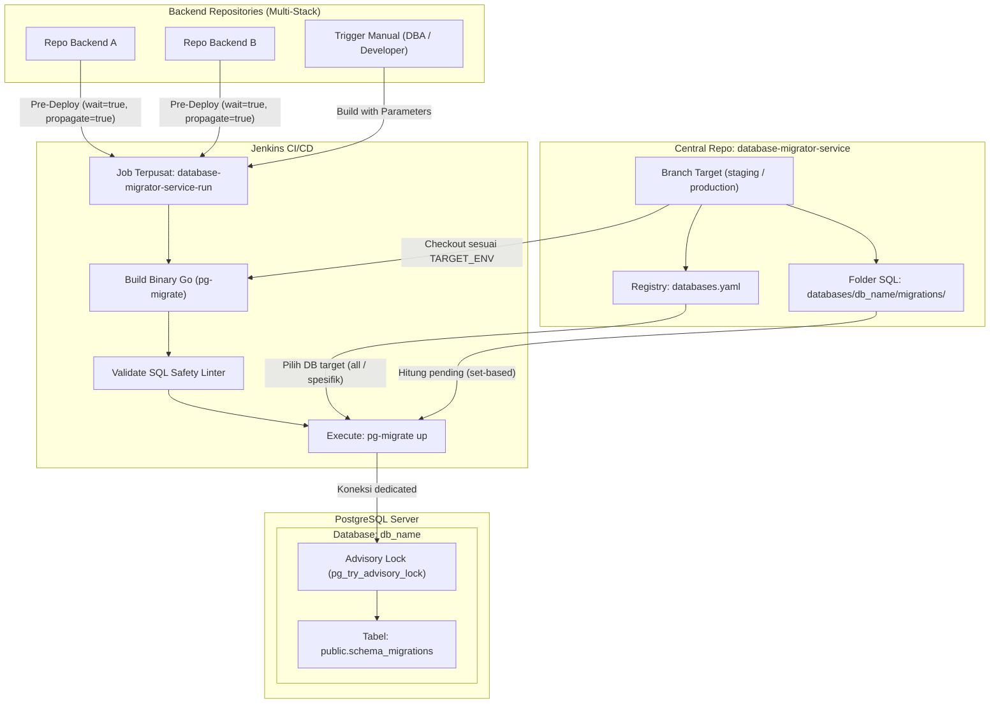
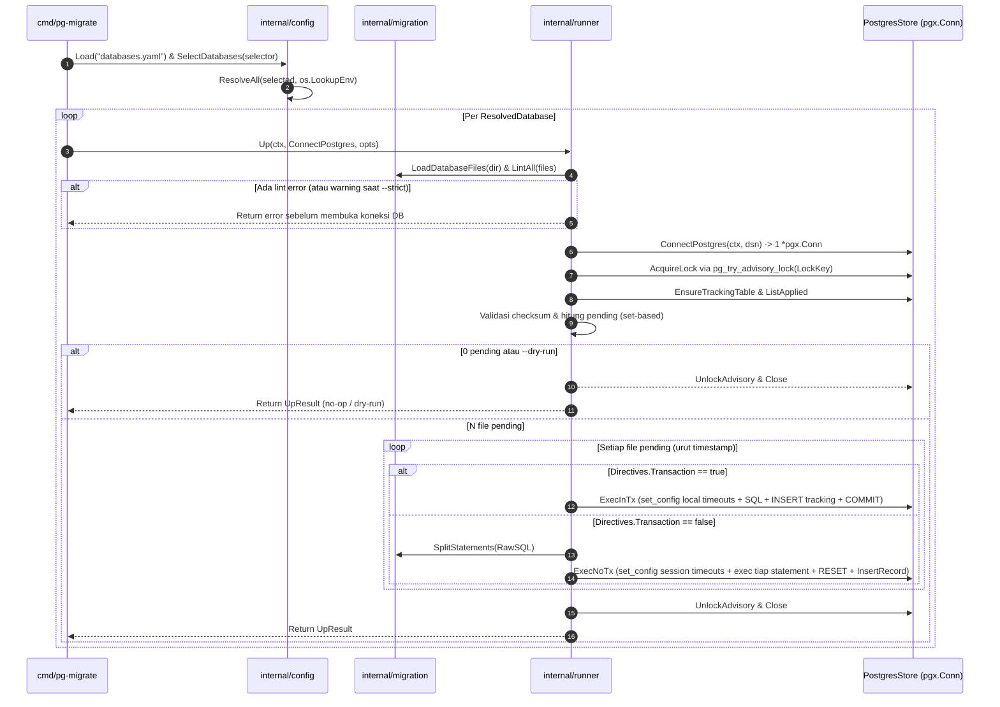

# Architecture

Dokumen ini menjelaskan struktur arsitektur internal `database-migrator-service`, batas tanggung jawab tiap paket Go, dan alur eksekusi dari trigger Jenkins hingga commit ke PostgreSQL.

## Gambaran Arsitektur

## Peta Paket & Batas Tanggung Jawab

| Paket | Lokasi | Tanggung Jawab | Dependensi Eksternal |
|---|---|---|---|
| **CLI (`main`)** | [`cmd/pg-migrate/main.go`](../../cmd/pg-migrate/main.go) | Parsing flag CLI (`up`, `status`, `validate`, `create`, `baseline`, `version`), membaca env metadata CI, dan memformat output terminal | Stdlib + paket `internal/*` |
| **Config** | [`internal/config/config.go`](../../internal/config/config.go) | Membaca & memvalidasi `databases.yaml`, menyeleksi database aktif, dan membangun DSN PostgreSQL dari env | `gopkg.in/yaml.v3` |
| **Migration** | [`internal/migration/`](../../internal/migration/parser.go) | Memuat file `baseline/` & `migrations/`, normalisasi line ending + SHA-256, parser directive, splitter statement PostgreSQL, dan safety linter statis | Stdlib saja (tanpa DB) |
| **Runner** | [`internal/runner/`](../../internal/runner/runner.go) | Orkestrasi advisory lock, cek riwayat & checksum, deteksi pending/DB_ONLY, eksekusi TX/no-TX melalui abstraksi `Store` (`PostgresStore`) | `github.com/jackc/pgx/v5` |

## Alur Eksekusi End-to-End (`pg-migrate up`)

## Prinsip Desain Utama

1. **Fail-fast sebelum menyentuh database**: Pada `runner.Up`, seluruh file lokal dimuat dan di-lint terlebih dahulu sebelum `connect(ctx)` dipanggil. Error sintaks atau linter tidak pernah membuka koneksi ataupun mengambil lock di PostgreSQL.
2. **Satu koneksi tunggal untuk session state**: `PostgresStore` tidak menggunakan connection pool (`pgxpool`), melainkan `pgx.Connect` tunggal per database, karena `pg_try_advisory_lock` dan `SET SESSION` terikat pada satu koneksi TCP PostgreSQL.
3. **Pure-stdlib migration parser**: Paket `internal/migration` bebas dari dependensi driver DB maupun I/O jaringan sehingga seluruh logika parsing, checksum, splitting, dan linting mudah diuji deterministik.
