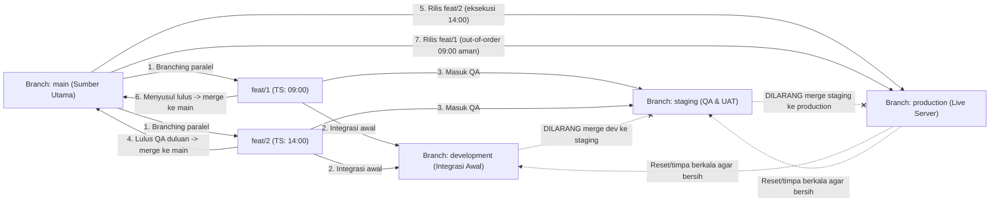

# SOP Branching & Out-of-Order Execution

Alur branching dirancang agar banyak fitur (`feat/1`, `feat/2`, `feat/3`) dapat diuji paralel sejak tahap integrasi `development` hingga QA di `staging` tanpa saling menyandera saat rilis ke `production` — serta memungkinkan `development` dan `staging` ditimpa ulang secara berkala agar tetap bersih dan dekat dengan kondisi `production`.

## Aturan Wajib

1. **Selalu buat branch `feat/*` dari `main`** — jangan pernah bercabang dari `development` atau `staging`, agar perubahan fitur lain yang masih belum siap tidak terbawa ke PR produksi Anda.
2. **Untuk integrasi awal (FE–BE / antar-service):** merge branch `feat/*` ke `development`, lalu deploy melalui Jenkins (`TARGET_ENV=development`).
3. **Untuk masuk QA/UAT:** merge branch `feat/*` yang sudah siap ke `staging`, lalu deploy melalui Jenkins (`TARGET_ENV=staging`).
4. **Revisi saat integrasi/QA di `development` atau `staging`:**
   - **JANGAN PERNAH** mengedit file `.sql` yang sudah sempat tereksekusi di shared DB (`development` atau `staging`) — hal itu akan memicu error `CHECKSUM_MISMATCH`.
   - Buat file migrasi baru (`pg-migrate create`) di branch fitur yang sama, lalu merge ulang ke branch environment terkait.
5. **DILARANG merge lintas environment (`development` → `staging`, `development` → `main`, `staging` → `main`, atau `staging` → `production`)!**
   - Jika `feat/2` (`20261126140000`) lulus QA lebih dulu daripada `feat/1` (`20261126090000`), cukup merge `feat/2` → `main` → `production`.
   - Ketika `feat/1` menyusul lulus nanti, merge `feat/1` → `main` → `production`. Karena tracking `pg-migrate` berbasis himpunan versi (*set-based*) di `public.schema_migrations`, runner tetap mengeksekusi `20261126090000` meskipun `20261126140000` sudah lebih dulu terpasang.
6. **Warning `APPLIED_IN_DB_NOT_IN_BRANCH` di `development` dan `staging`:**
   - Saat suatu branch fitur lain sedang aktif di `development` atau `staging` dan Anda menjalankan `up` dari branch yang belum memuat file fitur itu, `pg-migrate` mengeluarkan warning `APPLIED_IN_DB_NOT_IN_BRANCH` dan tetap sukses (`exit 0`). Ini kondisi normal di shared environment (`development`/`staging`).
   - Jika warning ini muncul di `production`, segera periksa apakah ada file migrasi yang pernah diterapkan di luar alur branch `production`.

## Reset / Timpa Berkala (Agar Dekat dengan `production`)

Karena branch `development` dan `staging` tidak pernah di-merge ke `production`, keduanya bisa dibersihkan dan ditimpa ulang secara berkala agar bebas dari sisa fitur yang batal atau eksperimen yang menumpuk:

1. **Reset branch Git (`development` atau `staging`)** ke posisi `origin/production` (atau `origin/main`) dengan `git push --force-with-lease`.
2. **Timpa database target (`development` atau `staging`)** menggunakan dump terbaru dari `production` (skema bersih / full dump yang sudah di-masking).
3. **Verifikasi & merge ulang hanya fitur yang masih aktif** (`feat/*` → `development`/`staging` → `ACTION=up` di Jenkins).

Ikuti runbook lengkap beserta checklist keamanannya di [Reset & Refresh `development` / `staging`](../operations/04_env-reset-and-refresh.md).
