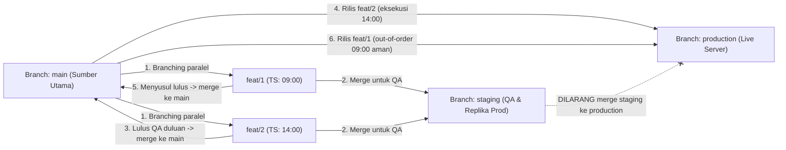

# SOP Branching & Out-of-Order Execution

Alur branching dirancang agar banyak fitur (`feat/1`, `feat/2`, `feat/3`) dapat dikembangkan dan diuji secara paralel di `staging` tanpa saling menyandera saat rilis ke `production`.

## Aturan Wajib

1. **Selalu buat branch `feat/*` dari `main`** — jangan pernah bercabang dari `staging`, agar perubahan fitur lain yang masih di-QA tidak terbawa ke PR produksi Anda.
2. **Untuk masuk QA/testing:** merge branch fitur ke `staging`, lalu deploy melalui Jenkins (`TARGET_ENV=staging`).
3. **Revisi saat testing di `staging`:**
   - **JANGAN PERNAH** mengedit file `.sql` yang sudah sempat tereksekusi di database `staging` — hal itu akan memicu error `CHECKSUM_MISMATCH`.
   - Buat file migrasi baru (`pg-migrate create`) di branch fitur yang sama, lalu merge ulang ke `staging`.
4. **DILARANG merge `staging` → `main` atau `staging` → `production`!**
   - Jika `feat/2` (`20261126140000`) lulus QA lebih dulu daripada `feat/1` (`20261126090000`), cukup merge `feat/2` → `main` → `production`.
   - Ketika `feat/1` menyusul lulus nanti, merge `feat/1` → `main` → `production`. Karena tracking `pg-migrate` berbasis himpunan versi (*set-based*) di `public.schema_migrations`, runner tetap mengeksekusi `20261126090000` meskipun `20261126140000` sudah lebih dulu terpasang.
5. **Warning `APPLIED_IN_DB_NOT_IN_BRANCH` di `staging`:**
   - Saat suatu branch fitur lain sedang aktif di `staging` dan Anda menjalankan `up` dari branch yang belum memuat file fitur itu, `pg-migrate` mengeluarkan warning `APPLIED_IN_DB_NOT_IN_BRANCH` dan tetap sukses (`exit 0`). Ini kondisi normal di `staging`.
   - Jika warning ini muncul di `production`, periksa apakah ada file migrasi yang pernah diterapkan di luar alur branch `production`.
